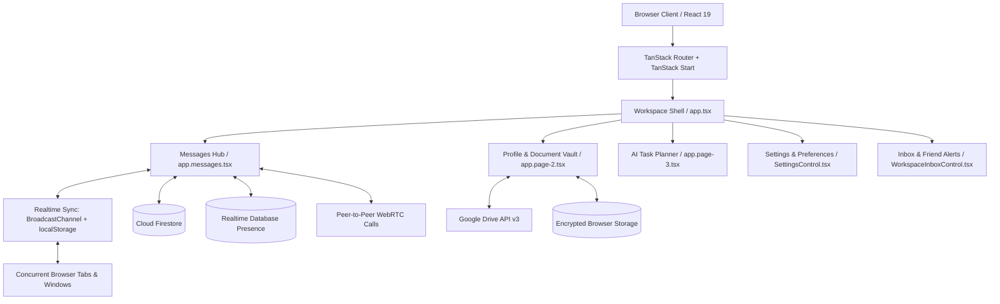
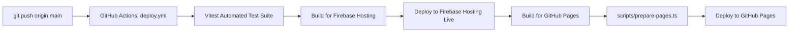

# Xperter: Complete Architectural Specification & Codebase Documentation

> **System Overview**: Xperter is an enterprise-grade, real-time collaboration and workspace platform engineered with a chrome-and-glass aesthetic. It features end-to-end encrypted messaging, peer-to-peer WebRTC voice/video calls, offline AI task auto-planning, password-protected personal document vaulting with Google Drive synchronization, and cross-tab/cross-device real-time event replication.

---

## Table of Contents
1. [High-Level System Architecture](#1-high-level-system-architecture)
2. [Technology Stack](#2-technology-stack)
3. [Repository Directory Layout](#3-repository-directory-layout)
4. [Routing & Application Pages (`src/routes/`)](#4-routing--application-pages-srcroutes)
5. [Core Services & Logic Engine (`src/lib/`)](#5-core-services--logic-engine-srclib)
6. [UI Components & Design System (`src/components/`)](#6-ui-components--design-system-srccomponents)
7. [Security Model & Firestore Access Rules (`firestore.rules`)](#7-security-model--firestore-access-rules-firestorerules)
8. [Task Automation & Natural Language Auto-Planner](#8-task-automation--natural-language-auto-planner)
9. [Build, Deployment & CI/CD Pipeline](#9-build-deployment--cicd-pipeline)

---

## 1. High-Level System Architecture



Xperter is built on a **multi-tiered architecture** designed to operate smoothly in both cloud-connected and offline/restricted environments:

1. **Presentation Layer**: Built on React 19 and Tailwind CSS v4 using modern OKLCH color palettes, backdrop filters, and custom glassmorphism styling.
2. **State & Real-time Layer**: A hybrid synchronization engine combining Firebase Cloud Firestore, Firebase Realtime Database (for presence detection), and a local `BroadcastChannel` + `localStorage` storage-event bus for instantaneous zero-latency replication across browser tabs.
3. **Identity & Directory Service**: A persistent Google Account Dictionary system that permanently maps Google emails to unique User IDs (`LMN-XXXXXX` or custom handles), preventing username recreation loops and enabling case-insensitive user search.
4. **Signaling & Media Engine**: Native WebRTC peer-to-peer audio and video calling coordinated via Firestore signaling documents with procedural Web Audio API sound synthesis.
5. **Secure Cloud Vault**: A zero-leakage document storage module that connects directly to Google Drive via client-side OAuth access tokens kept strictly in ephemeral memory.

---

## 2. Technology Stack

| Layer | Technologies | Rationale |
| :--- | :--- | :--- |
| **Framework & SSR** | TanStack Start, TanStack Router (v1.170), Vite 8 | Full-type-safe routing, code-splitting, fast cold boots, and Nitro server output. |
| **Frontend Core** | React 19, TypeScript 5.8 | Latest React hooks, strict type safety, zero legacy dependencies. |
| **Styling & Motion** | Tailwind CSS v4, tw-animate-css, GSAP, Lucide Icons | Hardware-accelerated transitions, OKLCH color spaces, and haptic animations. |
| **Backend & Cloud** | Firebase Auth, Cloud Firestore, Realtime Database | Serverless persistence, live query listeners, and presence detection. |
| **3D Rendering** | Three.js, React Three Fiber, Drei | Client-only lazy-loaded 3D chrome glyphs with zero SSR WebGL interference. |
| **NLP & AI Planning**| Compromise NLP, Levenshtein fuzzy matching | 100% client-side, zero-latency natural language task scheduling and typo tolerance. |
| **Testing & CI/CD** | Vitest, GitHub Actions, Firebase Hosting, GitHub Pages | Automated unit and integration testing with automated dual-target production deployments. |

---

## 3. Repository Directory Layout

```
Xperter/
├── .github/workflows/
│   └── deploy.yml              # Automated GitHub Pages & Firebase Hosting deployment pipeline
├── public/
│   └── assets/glyphs/          # Static pre-rendered 3D chrome glyph assets
├── scripts/
│   ├── deploy-firebase.ts      # Programmatic deployment script using Firebase REST API
│   └── prepare-pages.ts        # Pre-renders and prepares single-page 404 routing for GitHub Pages
├── src/
│   ├── assets/                 # SVGs, sound effects, and logo assets
│   ├── components/
│   │   ├── auth/               # Auth UI cards, fields, and unique username live checkers
│   │   ├── task-page/          # TodoView, AutoPlanner NLP engine, and Web Audio alarms
│   │   ├── three/              # Three.js 3D Chrome glyph canvases
│   │   ├── ui/                 # Accessible Radix UI primitives (Dialog, Popover, Button, etc.)
│   │   ├── BrandMark.tsx       # Procedural SVG brand badge
│   │   ├── GlassCard.tsx       # Core frosted-glass component wrapper
│   │   ├── LiquidEffects.tsx   # Ambient SVG lighting and liquid filters
│   │   ├── NotificationsAndInbox.tsx # Full notification center modal
│   │   ├── SettingsControl.tsx # Floating popover for themes, blur, and audio preferences
│   │   ├── SilkBackground.tsx  # Dynamic silky chromatic background
│   │   ├── UserSearchBar.tsx   # Live user search bar with debounced directory matching
│   │   └── WorkspaceInboxControl.tsx # Top-bar notification bell and friend request action controller
│   ├── hooks/                  # Custom React hooks (mobile detection, media queries)
│   ├── lib/
│   │   ├── auth.ts             # Authentication, Google Account Dictionary, and session engine
│   │   ├── config.ts           # Global page definitions, navigation metadata, and glyph routes
│   │   ├── conversations.ts    # Canonical conversation ID generator & directory search
│   │   ├── firebase.ts         # Firebase SDK configuration and Firestore error handlers
│   │   ├── google-drive-vault.ts # OAuth client for Google Drive `<username>_doc` folder vault
│   │   ├── notifications.ts    # Announcements and notification store
│   │   ├── prefs.ts            # Appearance preferences and reactive listener registry
│   │   ├── presence.ts         # Real-time online/offline presence tracking via RTDB
│   │   ├── realtime-sync.ts    # Cross-tab broadcast pipeline for requests, messages & directory
│   │   ├── username-id.ts      # Username validation, vault doc types, and rename eligibility
│   │   └── webrtc-calling.ts   # P2P WebRTC audio/video calling and procedural ringtone synthesis
│   ├── routes/
│   │   ├── __root.tsx          # Root route with theme provider and error boundaries
│   │   ├── app.tsx             # Main authenticated workspace shell with navigation overlay
│   │   ├── app.messages.tsx    # Live messaging, chat contacts, voice notes, and calls
│   │   ├── app.page-2.tsx      # Profile, custom User ID editor, and Document Vault
│   │   ├── app.page-3.tsx      # Personal Task & Habit Manager with NLP planner
│   │   ├── index.tsx           # Chrome landing page with GSAP animations
│   │   ├── sign-in.tsx         # Sign-in route (Google OAuth + Email/Password)
│   │   └── sign-up.tsx         # Account registration route with username availability check
│   ├── router.tsx              # TanStack router setup with dynamic basepath resolution
│   ├── server.ts               # Nitro SSR server entry
│   ├── start.ts                # TanStack Start hydration entry
│   └── styles.css              # Tailwind CSS v4 design tokens and custom utility classes
├── firestore.rules             # Comprehensive Cloud Firestore security blueprint
├── package.json                # Project dependencies and script declarations
├── vite.config.ts              # Vite configuration with Rolldown and Tailwind CSS plugins
└── vitest.config.ts            # Vitest unit and integration test runner config
```

---

## 4. Routing & Application Pages (`src/routes/`)

### `src/routes/__root.tsx`
- **Purpose**: The absolute root of the application hierarchy.
- **How It Works**:
  - Initializes `QueryClientProvider` from `@tanstack/react-query` to support server-state caching.
  - Injects global stylesheet `styles.css`.
  - Injects `<LiquidEffects />` to render subtle backdrop SVG blur filters.
  - Mounts `<Toaster />` from `sonner` for toast notifications.
  - Sets up error boundaries and a fallback 404 `NotFoundComponent`.

### `src/routes/index.tsx` (Landing Page)
- **Purpose**: Introduces users to Xperter with fluid visual aesthetics.
- **How It Works**:
  - Mounts `<SilkBackground />` and `<BrandMark />`.
  - Uses `gsap.context()` to orchestrate entrance animations (`.animate-rise`) on elements when not disabled by `prefers-reduced-motion`.
  - Checks `useAuthState()`; if already authenticated, offers a direct 1-click shortcut to `/app/messages`.

### `src/routes/sign-in.tsx` & `src/routes/sign-up.tsx`
- **Purpose**: User onboarding and session initiation.
- **How It Works**:
  - `sign-in.tsx`: Supports Google Single Sign-On via `signInWithGoogle()` and Email/Password via `signInWithEmailPassword()`. Remembers the last used email address via `REMEMBERED_EMAIL_KEY`.
  - `sign-up.tsx`: Integrates `<UniqueUsernameField />` to ensure a prospective User ID is valid, sanitized, and available before creating credentials.

### `src/routes/app.tsx` (Workspace Shell)
- **Purpose**: The layout container wrapping all `/app/*` routes.
- **How It Works**:
  - Renders top navigation bar containing the brand mark, navigation trigger button, `<WorkspaceInboxControl />`, and `<SettingsControl />`.
  - Implements a controlled **Radix Dialog modal portal** for workspace switching:
    - Never shifts the underlying DOM layout when opened.
    - Captures focus and supports `Escape` dismissal.
    - Routes between `Messages` (`/app/messages`), `Profile` (`/app/page-2`), and `Tasks` (`/app/page-3`).

### `src/routes/app.messages.tsx` (Messaging Hub)
- **File Size**: ~196 KB / 4,600+ lines.
- **Core Capabilities**:
  1. **Canonical Conversations**: Both users compute the identical conversation ID via `buildCanonicalConversationId()`.
  2. **Instagram-Style Live Search**: Typing a User ID (e.g. `LMN-MVHP6M` or `arthanareeshwara_891`) debounces a multi-source directory lookup across:
     - Shared cross-tab directory (`getSharedDirectoryUsers()`)
     - Google Account Dictionary (`listAllDictionaryAccounts()`)
     - Firestore `userDirectory` and `users` collections
  3. **Direct Friend Request Fallback**: If an ID has no public cloud profile yet, the UI provides an instant "Send Friend Request" action card.
  4. **Live Messaging & Replication**:
     - Sends text, polls (with live voting), audio voice notes (recorded via MediaRecorder API), and attachments.
     - Dual-persists messages to Firestore subcollection `/conversations/{id}/messages` and to `realtime-sync.ts`, broadcasting immediately across tabs.
  5. **WebRTC Calling**:
     - Includes integrated one-click Audio and Video calls.
     - Automatically generates call ringing tones using Web Audio API synthesis without external sound files.

### `src/routes/app.page-2.tsx` (Profile & Document Vault)
- **Core Capabilities**:
  1. **Identity Management**: Edit display name, about bio, and custom User ID.
  2. **Username Rename Limiting**: Implements a 3-rename limit per 14-day rolling window (`checkUsernameRenameEligibility()`).
  3. **Google Drive Document Vault**:
     - Authorizes Google Drive access via `GOOGLE_DRIVE_SCOPE` (`drive.file`).
     - Ensures creation of `<username>_doc` folder in the user's personal Google Drive.
     - Stores government identity documents (Aadhaar, Voter ID, PAN, Passbook, Passport, etc.).
     - Generates synthetic document previews with SVG watermarks (`buildDocumentPreviewSvgDataUrl()`).
     - Password-protects the vault with client-side SHA-256 salt hashing (`verifyVaultPassword()`).

### `src/routes/app.page-3.tsx` (Task Manager & Auto-Planner)
- Mounts `<TodoView />` from `src/components/task-page/` for natural-language habit and task automation.

---

## 5. Core Services & Logic Engine (`src/lib/`)

### `src/lib/auth.ts`
- **Purpose**: The central authentication and identity vault.
- **Key Algorithms**:
  - `ACCOUNT_DICTIONARY_KEY`: Stores a permanent dictionary mapping Google email accounts to unique User IDs (`usernameId`). When an account logs out and logs back in, its assigned ID is always reused and never randomized again.
  - `toAppUser()`: Transforms Firebase Auth credentials into internal `AppUser` representation, prioritizing user-chosen overrides over stale cached entries.
  - `updateUserProfile()`: Atomic function that writes display name, User ID, and photo updates to local storage, Account Dictionary, Firestore `/users/{uid}`, and `/userDirectory/{lumenId}`.

### `src/lib/realtime-sync.ts`
- **Purpose**: High-speed, cross-tab and cross-window real-time synchronization layer.
- **How It Works**:
  - Instantiates a browser `BroadcastChannel("xperter_realtime_sync")` combined with a `window.addEventListener("storage")` fallback.
  - Exposes broadcast events:
    - `FRIEND_REQUEST_SENT`
    - `FRIEND_REQUEST_UPDATED` (accepted / declined)
    - `CONVERSATION_UPSERTED`
    - `MESSAGE_SENT`
    - `USER_DIRECTORY_UPDATED`
  - Guarantees instant (0 ms latency) message delivery between multiple browser tabs of the same computer even before Firestore network round-trips complete.

### `src/lib/conversations.ts`
- **Key Functions**:
  - `buildCanonicalConversationId(lumenIdA, lumenIdB)`:
    Normalizes and sorts both participant IDs alphabetically:
    ```typescript
    const sorted = [normA, normB].sort();
    return `conv_${sorted[0]}_${sorted[1]}`;
    ```
    This mathematical invariant guarantees that both User 1 and User 2 compute the **exact same conversation ID**, preventing split chat rooms.
  - `searchUsersInFirestore(rawQuery, currentUser)`: Exhaustive search aggregator querying local dictionary, shared real-time cache, Firestore `userDirectory`, and Firestore `users`.

### `src/lib/webrtc-calling.ts`
- **Purpose**: Peer-to-peer real-time communication for audio and video calls.
- **How It Works**:
  - Uses STUN servers (`stun.l.google.com:19302`).
  - Stores call session documents under `/calls/{callId}` in Firestore with fields: `callerUid`, `calleeUid`, `offer` (SDP), `answer` (SDP), and `status` (`ringing`, `connected`, `ended`, `declined`).
  - Synthesizes procedural ringing audio via `AudioContext` sine-wave oscillators (`startRingingTone()`).

### `src/lib/google-drive-vault.ts`
- **Purpose**: Interfacing with the Google Drive v3 REST API.
- **Security Best Practice**: The OAuth 2.0 `accessToken` is stored **strictly in ephemeral memory variables** (`cachedDriveAccessToken`) and is never written to `localStorage` or `sessionStorage`.
- **Operations**:
  - Searches for or creates folder `<username>_doc`.
  - Uploads multipart MIME documents with standardized naming (`<username>_<docType>.<ext>`).

### `src/lib/presence.ts`
- **Purpose**: Detects user presence via Firebase Realtime Database.
- **How It Works**:
  - Monitors `.info/connected`.
  - Sets up `onDisconnect(ref).set({ state: "offline", lastChanged: serverTimestamp() })`.
  - Automatically flips to `"online"` when active and `"offline"` when the tab is closed or connection drops.

### `src/lib/prefs.ts`
- **Purpose**: System-wide visual preferences.
- **Properties**: `theme` (`light` | `dark`), `motion`, `glyphs`, `sounds`, `compact`, `blur` (glass frosting), `alpha`, `hue` (color tints: Pearl, Champagne, Mist, Blush).
- Automatically updates `document.documentElement` class list (`.dark`) and CSS custom properties (`--blur`, `--frost-alpha`, `--theme-hue`).

---

## 6. UI Components & Design System (`src/components/`)

### `src/components/WorkspaceInboxControl.tsx`
- **Top Navigation Bell Icon**: Displays an active notification count badge.
- **Friend Request Handler**:
  - Subscribes in real time to both Firestore and `realtime-sync.ts`.
  - Renders inline **Accept** and **Decline** buttons for incoming friend requests.
  - On Accept: sets status to `"accepted"`, marks notification as read, registers canonical conversation, and navigates directly into the new chat.

### `src/components/SettingsControl.tsx`
- **Settings Popover**: Radix Popover anchored to the header gear button.
- Controls theme mode (Light/Dark), glass blur slider, sound effects toggle, and animation toggles.
- Plays synthesized liquid clicks using the Web Audio API on trigger.

### `src/components/three/ChromeGlyph.tsx` & `ChromeScene.tsx`
- **3D Glyph Renderer**:
  - Lazy-loaded client-side component using `@react-three/fiber` and `@react-three/drei`.
  - Renders reflective chrome materials (`MeshTransmissionMaterial` / metallic roughness shading) without blocking SSR.

### `src/components/auth/UniqueUsernameField.tsx`
- **Username Input Component**:
  - Debounces availability checks against both Firestore and local dictionary.
  - Includes a **Randomize ID** button generating guaranteed-available unique handle suggestions.

---

## 7. Security Model & Firestore Access Rules (`firestore.rules`)

Xperter enforces a strict **Default-Deny Catch-All** security posture:

```javascript
rules_version = '2';
service cloud.firestore {
  match /databases/{database}/documents {
    match /{document=**} {
      allow read, write: if false; // Default deny
    }
```

### Security Collections & Rules

1. **`/users/{userId}`**:
   - `get, list`: Allowed for authenticated/verified users so friends can be searched.
   - `create, update, delete`: Restricted strictly to `request.auth.uid == userId` (`isOwner`).
   - Validates required fields: `uid`, `displayName`, `email`, `createdAt`, `updatedAt`.
2. **`/userDirectory/{lumenId}`**:
   - `get, list`: Publicly readable non-PII index mapping `lumenId` -> `uid`, `displayName`, and `handle`.
   - `create, update, delete`: Only the owner of the UID can write or mutate their directory entry.
3. **`/friendRequests/{requestId}`**:
   - `get, list`: Allowed if the user is either the sender (`fromUid`) or recipient (`toUid` / `toLumenId`).
   - `create`: Sender must match `request.auth.uid` with initial status `'pending'`.
   - `update`: Allows updating status to `'accepted'` or `'declined'` by recipient.
4. **`/conversations/{conversationId}`**:
   - Access allowed only if `request.auth.uid == resource.data.ownerId` or `request.auth.uid in resource.data.participantIds` or `participantLumenIds` list matches.
5. **`/conversations/{conversationId}/messages/{messageId}`**:
   - Parent conversation membership is verified using `isConversationMember(conversationId)` before allowing message creation or listing.
   - Enforces limits: text length <= 2000 characters, attachments <= 500 KB, poll options <= 4.
6. **`/calls/{callId}`**:
   - Signaling documents readable and writable only by either `callerUid` or `calleeUid`.

---

## 8. Task Automation & Natural Language Auto-Planner

Located in `src/components/task-page/`:
- **`autoPlanner.ts`**:
  - Powered by `compromise` NLP library.
  - Parses freeform English prompts like:
    > *"Workout tomorrow morning at 7am and call Alex every weekday at 6pm priority high"*
  - **Fuzzy Typo Tolerant**: Employs Levenshtein distance calculations to auto-correct typos (e.g. `"tomorow"`, `"evryday"`, `"priorty"`) with zero cloud latency.
  - Automatically categorizes items as `"habit"` (recurring schedules) or `"task"` (one-off deadlines).
- **`alarmAudio.ts`**:
  - Generates custom multi-frequency alarm chimes procedurally using `AudioContext`, requiring zero MP3/WAV network downloads.

---

## 9. Build, Deployment & CI/CD Pipeline

The project supports dual deployment targets:



1. **Automated Test Suite**:
   - `vitest run`: Runs 9 test suites (35 unit and integration tests) verifying routing, Radix UI settings, task parsing, Firestore security rules, and profile vault logic.
2. **Firebase Hosting Deployment**:
   - Triggered when secrets `FIREBASE_SERVICE_ACCOUNT` are present.
   - Executes `bun run scripts/deploy-firebase.ts` which uses Google OAuth access tokens to package and deploy hosting releases to Firebase project `xperter-workspace`.
3. **GitHub Pages Deployment**:
   - Executes `bun run scripts/prepare-pages.ts`, creating static fallbacks and copy-routing for deep routes (`/app/messages`, `/app/page-2`, `/app/page-3`).
   - Deploys static build to GitHub Pages via `actions/deploy-pages@v4`.

---

## Summary of Recent Critical Enhancements

1. **Persistent Google Account Dictionary**:
   - Resolved the issue where logging out and logging back in generated a new randomized User ID. The dictionary guarantees lifelong ID reuse.
2. **Canonical Conversation IDs**:
   - Replaced one-way IDs with sorted canonical IDs (`conv_userA_userB`), ensuring both participants join the exact same message thread.
3. **Cross-Tab Real-Time Sync**:
   - Built `src/lib/realtime-sync.ts` allowing messages, friend requests, and user registrations to synchronize across browser tabs in real time.
4. **Resilient User ID Directory Search**:
   - Expanded live search in `src/routes/app.messages.tsx` and `src/lib/conversations.ts` to query across shared directories, account dictionaries, and Firestore with direct friend request fallbacks.
